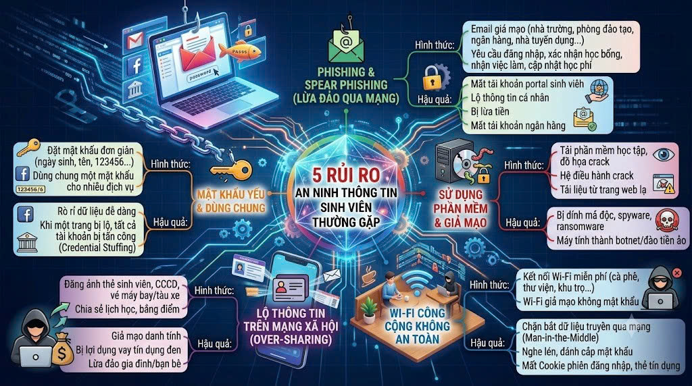
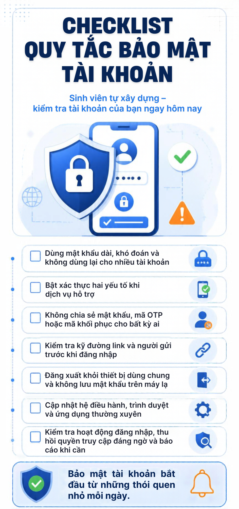
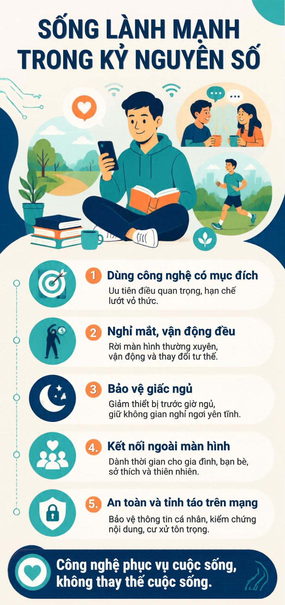
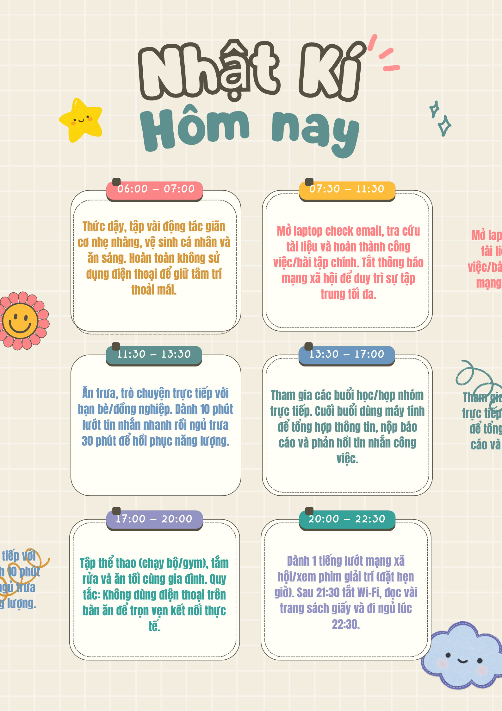

# ThucHanh09_Nhom4_D13_NenTangCNS
## Nội dung thực hành bài 9
**Tiết 1: Tự khám phá rủi ro an ninh số**

**Nhiệm vụ**: Làm khảo sát nhanh bằng Google Form về: thói quen đặt mật khẩu, tần suất dùng mạng xã hội, từng gặp rủi ro gì.

Link Google Form: [Tại đây](https://docs.google.com/forms/d/e/1FAIpQLScRaMbL0-1X5vcZgOegVz6eMmiE16zaFvNJM9VxpVRJsjzLOA/viewform?usp=dialog)

Vẽ sơ đồ tư duy về rủi ro an ninh thông tin sinh viên có thể gặp.

**Tiết 2: Tự rèn kỹ năng bảo mật tài khoản**

Checklist “Quy tắc bảo mật tài khoản” do sinh viên tự xây dựng

**Tiết 3: Thực hành nhận diện lừa đảo & nguy cơ online**

Báo cáo ngắn của nhóm: “5 dấu hiệu nhận biết email/website lừa đảo”

**Tiết 4: Tự quản lý sức khỏe số**

Poster nhóm

Nhật ký cá nhân

**Tiết 5: Dự án tình huống & phản biện**

Video/clip ngắn hoặc kịch bản tình huống + phần phản biện.: 
